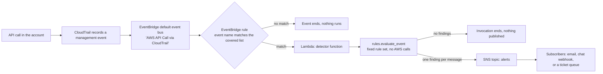

# Architecture

## What this solves

A dangerous change in an AWS account is silent. The API call
succeeds, the console moves on, and nobody hears about it until a
scanner finds the new state hours later, an auditor asks
questions months later, or an attacker finds the opening first.
The gap between the change and anyone knowing is where the
damage sits.

AWS sells answers to this. Config rules evaluate resource state,
Security Hub collects findings, and GuardDuty watches for
threats. They are good tools, and in a large account they are
probably the right ones. What I wanted here was the same
detection path at a size I can hold in my head and own end to
end: the account's audit log as the source, a fixed set of rules
I wrote and can explain line by line, and an alert a human can
act on while the change is still fresh. Building it myself is
also part of the point. Reading my own rules teaches me more
about what the managed services do underneath than turning one
on would.

## Flow

One precondition sits under the whole diagram: a CloudTrail
trail has to be logging management events in the region. Without
a trail, events never reach the bus and the rest of the flow has
nothing to work on. The template assumes that trail exists; it
does not create one.

The same flow as a numbered walk:

1. Someone or something makes an API call in the account: a bucket
   policy changes, a security group opens, a trail stops.
2. CloudTrail records it as a management event. EventBridge picks
   the event up from the default event bus in the
   "AWS API Call via CloudTrail" shape. No custom bus and no log
   scraping are involved.
3. One EventBridge rule filters by event name. Only the fifteen
   API calls the rule set understands get forwarded. Everything
   else ends at the rule and costs nothing further.
4. The Lambda function hands the event to
   `rules.evaluate_event`. The evaluator is a separate module with
   no AWS imports, which is why the demo and the tests can run the
   exact production logic on a laptop.
5. Each finding becomes one SNS message on the alerts topic, with
   the severity and rule id in the subject and the explanation and
   fix in the body. Subscribers decide where alerts land: an
   inbox, a chat channel through a webhook, or a queue feeding a
   ticket system.

## Components

| Piece | What it does | Where it lives |
|---|---|---|
| CloudTrail trail | Records management events for the account | Account level; the template assumes one exists (see the deployment notes in README.md) |
| EventBridge rule | Forwards only the covered event names | `template.yaml`, `MisconfigEvents` event on the function |
| Lambda function | Runs the handler, publishes findings | `src/handler.py` |
| Evaluation core | The nine rules and the finding shape | `src/rules.py` |
| SNS topic | Fans findings out to subscribers | `template.yaml`, `AlertsTopic` |

## Why these services

Each piece is here for a reason, and each had an alternative I
turned down.

**CloudTrail, because it is already the record.** Every API call
in the account lands here with the actor, the time, and the
request details. The alternative was polling each service's own
APIs to reconstruct state, which means read access everywhere, a
separate code path per service, and results that only show the
state after the fact. Judging the event CloudTrail already
recorded needs none of that.

**EventBridge, because change detection should be event-driven,
not scheduled.** The obvious alternative is a scanner on a cron
schedule that lists resources and checks them. That shape finds
problems late by design, and it pays for full account scans to
catch the one call that mattered. EventBridge puts the event in
front of the function within minutes of the call, and the rule
throws away everything the rule set does not cover before any
code runs. The trade-off: delivery depends on a trail logging
management events in that region. No trail, no events, no
detection, and the failure is silence rather than an error.

**Lambda, because there is nothing to run between events.** A
long-running server or a container would sit idle almost all of
the time, and I would own its patching, its scaling, and its
uptime for a job that takes milliseconds per event. Lambda runs
only when a covered event arrives, scales on its own, and costs
nothing at idle. The trade-offs are cold starts, which add a
small delay to an alert path that already waits on CloudTrail
delivery, and the discipline of keeping the function small and
stateless, which the separate evaluation core enforces anyway.

**SNS, because alert destinations change more often than
detection logic.** I could have hardcoded an email address or a
chat webhook inside the function. Then every change of inbox,
channel, or on-call tool means editing and redeploying the
detector. With a topic, subscribers come and go without the
function changing at all. The trade-off is that SNS only
delivers messages. It does not track whether anyone acted, chase
a human who ignored it, or close the loop, so remediation
tracking has to live somewhere else.

**SAM, because the stack is small and the template should read
like it.** Clicking through the console would work once and
leave nothing reviewable behind. Raw CloudFormation would say
the same thing in far more YAML. SAM keeps the function, the
event rule, and the topic in one short file that a reader can
audit in a minute, and the local validator can check its
structure without an account.

## The rule set

| Rule id | Event names | Severity | Fires when |
|---|---|---|---|
| S3_PUBLIC_POLICY | PutBucketPolicy | critical | The policy grants an Allow to a public principal |
| S3_PUBLIC_ACL | PutBucketAcl | critical | The ACL grants AllUsers or AuthenticatedUsers |
| SG_OPEN_INGRESS | AuthorizeSecurityGroupIngress | critical or high | An ingress rule opens 0.0.0.0/0 or ::/0; critical when SSH, RDP, or all ports are in range |
| IAM_WILDCARD_ADMIN | CreatePolicy, PutUserPolicy, PutRolePolicy, PutGroupPolicy, AttachUserPolicy, AttachRolePolicy, AttachGroupPolicy | critical | A policy document allows every action on every resource, or AdministratorAccess is attached |
| ROOT_CONSOLE_LOGIN | ConsoleLogin | high | The root user signs in successfully |
| CONSOLE_LOGIN_NO_MFA | ConsoleLogin | medium | An IAM user signs in successfully with MFAUsed set to No |
| TRAIL_LOGGING_OFF | StopLogging, DeleteTrail | high | A trail is stopped or deleted |
| SNAPSHOT_PUBLIC | ModifySnapshotAttribute | high | A snapshot is shared with the 'all' group |
| EBS_VOLUME_UNENCRYPTED | CreateVolume | medium | A volume is created with encryption off |

## Permissions

The function holds exactly one permission: `sns:Publish`, scoped
to its own topic. It cannot read the account, list resources, or
change anything. Detection is read-only by construction, because
the input is the event itself rather than an API call back into
the account. If a rule ever needs to look something up, that will
be a deliberate, documented widening of this role, not an accident
of a broad managed policy.

## Cost at idle

Effectively zero, and the shape of the design is why:

- **EventBridge** does not charge for AWS service events on the
  default event bus, and CloudTrail events are AWS service events.
- **Lambda** charges per invocation and per millisecond. No
  covered API call means no invocation, so an idle account pays
  nothing here. Covered calls are rare in a normal account, and
  the free tier absorbs the first million requests a month anyway.
- **SNS** charges per published message past the free tier. No
  findings means no messages.
- **CloudTrail** is the one piece with a standing cost shape of
  its own. The first trail delivering management events to S3 is
  free apart from S3 storage for the log files, which is small.
  Most accounts I would deploy this in already run a trail, in
  which case this project adds nothing at all to that line.

So the honest summary: in an account that already has a trail,
the detector costs nothing at idle and close to nothing in a
normal month of use.

## Region scope

EventBridge rules and Lambda functions are regional, and
CloudTrail puts an event on the bus in the region where the API
call happened. One deployment watches one region. IAM and console
sign-in events surface in us-east-1, which is why that is the
natural first region, but an S3 or EC2 change in another region
stays invisible until the stack is deployed there too or a
multi-region setup feeds the events into one place. README.md
lists this in the limitations, because it is the easiest way to
overestimate what a single deployment sees.
