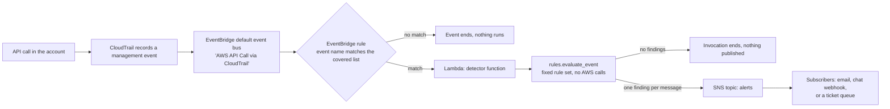

# Architecture

## Flow

The same flow as a numbered walk:

1. Someone or something makes an API call in the account: a bucket
   policy changes, a security group opens, a trail stops.
2. CloudTrail records it as a management event. EventBridge picks
   the event up from the default event bus in the
   "AWS API Call via CloudTrail" shape. No custom bus and no log
   scraping are involved.
3. One EventBridge rule filters by event name. Only the fifteen
   API calls the rule set understands get forwarded. Everything
   else ends at the rule and costs nothing further.
4. The Lambda function hands the event to
   `rules.evaluate_event`. The evaluator is a separate module with
   no AWS imports, which is why the demo and the tests can run the
   exact production logic on a laptop.
5. Each finding becomes one SNS message on the alerts topic, with
   the severity and rule id in the subject and the explanation and
   fix in the body. Subscribers decide where alerts land: an
   inbox, a chat channel through a webhook, or a queue feeding a
   ticket system.

## Components

| Piece | What it does | Where it lives |
|---|---|---|
| CloudTrail trail | Records management events for the account | Account level; the template assumes one exists (see the deployment notes in README.md) |
| EventBridge rule | Forwards only the covered event names | `template.yaml`, `MisconfigEvents` event on the function |
| Lambda function | Runs the handler, publishes findings | `src/handler.py` |
| Evaluation core | The nine rules and the finding shape | `src/rules.py` |
| SNS topic | Fans findings out to subscribers | `template.yaml`, `AlertsTopic` |

## The rule set

| Rule id | Event names | Severity | Fires when |
|---|---|---|---|
| S3_PUBLIC_POLICY | PutBucketPolicy | critical | The policy grants an Allow to a public principal |
| S3_PUBLIC_ACL | PutBucketAcl | critical | The ACL grants AllUsers or AuthenticatedUsers |
| SG_OPEN_INGRESS | AuthorizeSecurityGroupIngress | critical or high | An ingress rule opens 0.0.0.0/0 or ::/0; critical when SSH, RDP, or all ports are in range |
| IAM_WILDCARD_ADMIN | CreatePolicy, PutUserPolicy, PutRolePolicy, PutGroupPolicy, AttachUserPolicy, AttachRolePolicy, AttachGroupPolicy | critical | A policy document allows every action on every resource, or AdministratorAccess is attached |
| ROOT_CONSOLE_LOGIN | ConsoleLogin | high | The root user signs in successfully |
| CONSOLE_LOGIN_NO_MFA | ConsoleLogin | medium | An IAM user signs in successfully with MFAUsed set to No |
| TRAIL_LOGGING_OFF | StopLogging, DeleteTrail | high | A trail is stopped or deleted |
| SNAPSHOT_PUBLIC | ModifySnapshotAttribute | high | A snapshot is shared with the 'all' group |
| EBS_VOLUME_UNENCRYPTED | CreateVolume | medium | A volume is created with encryption off |

## Permissions

The function holds exactly one permission: `sns:Publish`, scoped
to its own topic. It cannot read the account, list resources, or
change anything. Detection is read-only by construction, because
the input is the event itself rather than an API call back into
the account. If a rule ever needs to look something up, that will
be a deliberate, documented widening of this role, not an accident
of a broad managed policy.

## Cost at idle

Effectively zero, and the shape of the design is why:

- **EventBridge** does not charge for AWS service events on the
  default event bus, and CloudTrail events are AWS service events.
- **Lambda** charges per invocation and per millisecond. No
  covered API call means no invocation, so an idle account pays
  nothing here. Covered calls are rare in a normal account, and
  the free tier absorbs the first million requests a month anyway.
- **SNS** charges per published message past the free tier. No
  findings means no messages.
- **CloudTrail** is the one piece with a standing cost shape of
  its own. The first trail delivering management events to S3 is
  free apart from S3 storage for the log files, which is small.
  Most accounts I would deploy this in already run a trail, in
  which case this project adds nothing at all to that line.

So the honest summary: in an account that already has a trail,
the detector costs nothing at idle and close to nothing in a
normal month of use.

## Region scope

EventBridge rules and Lambda functions are regional, and
CloudTrail puts an event on the bus in the region where the API
call happened. One deployment watches one region. IAM and console
sign-in events surface in us-east-1, which is why that is the
natural first region, but an S3 or EC2 change in another region
stays invisible until the stack is deployed there too or a
multi-region setup feeds the events into one place. README.md
lists this in the limitations, because it is the easiest way to
overestimate what a single deployment sees.
