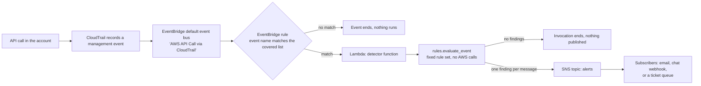

# Cloud Misconfiguration Detector

An event-driven detector I built for the AWS mistakes that cause
breaches: a bucket made public, a security group opened to the
world, an admin policy handed out, a trail switched off. It
watches CloudTrail through EventBridge, scores each covered API
call against a fixed set of rules in a Lambda function, and sends
findings to SNS the moment the change happens.

## Story

Most cloud breaches I read about do not start with an exotic
exploit. They start with a setting. A bucket policy with the wrong
principal. A security group opened to 0.0.0.0/0 for a quick test
and never closed. AdministratorAccess attached because it was
faster than writing a scoped policy. The change takes seconds, it
is made by someone authorized to make it, and nothing complains.

Periodic scanners catch these on their next run, which might be
hours or days later. I wanted the other shape: detection at the
moment of the change, built from the account's own audit log.
CloudTrail already records every one of these calls. The work is
to listen properly, judge each event against clear rules, and put
a plain-language alert with a fix in front of a human while the
change is still fresh.

So I built it as a small event-driven system: CloudTrail events
flow through EventBridge to one Lambda function, the function
evaluates the event against nine rules, and findings go out over
SNS. The evaluation core is plain Python with no AWS calls inside,
so the whole rule set can be tested locally against fictional
events, and the deployed function is a thin shell around the same
code the tests exercise.

## How it works

Five steps, each a separate piece:

1. **Record.** CloudTrail logs the API call as a management
   event. EventBridge receives it on the default bus in the
   "AWS API Call via CloudTrail" shape.
2. **Filter.** One EventBridge rule forwards only the fifteen
   event names the rules understand: the S3, security group, IAM,
   sign-in, CloudTrail, and EBS calls listed in ARCHITECTURE.md.
3. **Evaluate.** The Lambda handler passes the event to
   `rules.evaluate_event`. Each rule reads the event's detail,
   decides whether the change is a misconfiguration, and returns
   a finding with a severity, the resource and actor from the
   event, a plain-language explanation, and the remediation step.
4. **Alert.** One SNS message per finding, severity and rule id
   in the subject, explanation and fix in the body.
5. **Stay silent otherwise.** Benign changes produce no message.
   A detector that cries wolf on safe changes gets muted, and a
   muted detector is worse than none.

The flow as a diagram, the same one ARCHITECTURE.md walks
through in full:



One precondition sits under the whole diagram: a CloudTrail
trail has to be logging management events in the region, or the
events never reach the bus and nothing downstream runs.

The nine rules: public S3 bucket policy, public S3 ACL, security
group ingress open to the internet (rated critical when SSH, RDP,
or all ports are in range, high otherwise), IAM policies granting
every action on every resource (written or attached), root
console sign-in, console sign-in without MFA, CloudTrail logging
stopped or deleted, EBS snapshot shared publicly, and EBS volume
created without encryption.

Full detail, including the diagram, the rule table, and the cost
breakdown, is in [ARCHITECTURE.md](ARCHITECTURE.md).

### Decisions

- **Events, not scans.** A scanner that polls the account sees
  the state after the fact and needs read permissions everywhere.
  An event-driven detector sees the change as it happens and
  needs no read permissions at all, because the event itself
  carries the facts. The trade is real and stated in the
  limitations: anything that never produces a covered API call
  stays invisible.
- **The evaluation core is separate from the handler.** Rules
  live in `src/rules.py` with no AWS imports and no boto3. The
  handler in `src/handler.py` only moves data: event in, SNS
  messages out, with the SNS client lazy-imported and injectable.
  That split is what lets 38 tests and a full demo run locally
  with the standard library alone.
- **One permission.** The function's role holds exactly
  `sns:Publish` on its own topic. It cannot read the account and
  cannot fix anything. Alerting is its whole job; remediation
  stays a human decision, which is the right shape for a
  detector.
- **Benign samples are first-class.** Five of the sixteen sample
  events are safe lookalikes: a /32 ingress rule, a scoped
  policy, an MFA sign-in, a private bucket policy, an encrypted
  volume. The tests pin their silence as firmly as the other
  eleven findings.
- **Root sign-ins get one alert, not two.** A root sign-in
  without MFA matches both sign-in rules on paper. I scoped the
  no-MFA rule to IAM users so one event produces one finding,
  because duplicate alerts for a single action teach people to
  skim.
- **Rules fail quiet, never loud.** CloudTrail request shapes
  vary by service and drift over time. A rule that cannot read
  its event returns no finding, and the evaluator guards each
  rule call, so one malformed event cannot crash the function or
  hide the findings from the other rules.

## Output

Run the local demo. It feeds all sixteen fictional sample events
through the same evaluator the Lambda runs:

```bash
python3 run_demo.py
```

Real output from that run:

```
Running 16 sample events through the detector...

--- 001-s3-public-policy.json
Event: PutBucketPolicy by arn:aws:iam::123456789012:user/alex.admin
Finding: [CRITICAL] S3_PUBLIC_POLICY on fictional-reports-bucket
  The new bucket policy allows access from any principal, which means anyone on the internet can use the permissions it grants on this bucket, no AWS account needed.
  Fix: Remove the public principal from the bucket policy, turn on S3 Block Public Access for the bucket, and grant access to named principals only.

--- 002-s3-public-acl.json
Event: PutBucketAcl by arn:aws:iam::123456789012:user/alex.admin
Finding: [CRITICAL] S3_PUBLIC_ACL on fictional-assets-bucket
  The bucket ACL grants the AllUsers group access. AllUsers means anyone on the internet; AuthenticatedUsers means anyone with any AWS account. Either way the bucket is no longer private.
  Fix: Remove the public group grant from the ACL, turn on S3 Block Public Access, and use a bucket policy with named principals for any access that is genuinely needed.

--- 003-sg-open-ssh.json
Event: AuthorizeSecurityGroupIngress by arn:aws:iam::123456789012:user/alex.admin
Finding: [CRITICAL] SG_OPEN_INGRESS on sg-0123456789abcdef0
  This rule lets any address on the internet reach the group, including SSH or RDP ports. The sources are 0.0.0.0/0, which is every IPv4 or IPv6 address there is.
  Fix: Replace the open range with the specific source addresses that need access, and use a VPN, a bastion, or Systems Manager Session Manager instead of exposing admin ports.

--- 004-sg-open-ipv6-web.json
Event: AuthorizeSecurityGroupIngress by arn:aws:iam::123456789012:user/jordan.dev
Finding: [HIGH] SG_OPEN_INGRESS on sg-0123456789abcdef1
  This rule lets any address on the internet reach the group, on port 443. The sources are ::/0, which is every IPv4 or IPv6 address there is.
  Fix: Replace the open range with the specific source addresses that need access, and use a VPN, a bastion, or Systems Manager Session Manager instead of exposing admin ports.

--- 005-iam-wildcard-policy.json
Event: CreatePolicy by arn:aws:iam::123456789012:user/alex.admin
Finding: [CRITICAL] IAM_WILDCARD_ADMIN on fictional-helper-policy
  The policy allows every action on every resource. Whoever holds it can read, change, or delete anything in the account, and can grant themselves any other permission.
  Fix: Rewrite the policy with only the actions and resources the work needs, and split broad permissions across separate policies so each one stays reviewable.

--- 006-iam-attach-admin.json
Event: AttachUserPolicy by arn:aws:iam::123456789012:user/alex.admin
Finding: [CRITICAL] IAM_WILDCARD_ADMIN on jordan.dev
  The AWS managed AdministratorAccess policy was attached. It allows every action on every resource, so the holder now has full control of the account.
  Fix: Detach AdministratorAccess and attach a policy scoped to the actions and resources the work actually needs.

--- 007-root-console-login.json
Event: ConsoleLogin by arn:aws:iam::123456789012:root
Finding: [HIGH] ROOT_CONSOLE_LOGIN on arn:aws:iam::123456789012:root
  The account root user signed in. Root can do anything in the account, including closing it, and its actions cannot be limited by IAM policies. Day to day work should never need it.
  Fix: Confirm this sign-in was expected. Do daily work with an IAM identity instead, keep root credentials locked away with MFA on, and set a standing alert on any root use.

--- 008-console-login-no-mfa.json
Event: ConsoleLogin by arn:aws:iam::123456789012:user/jordan.dev
Finding: [MEDIUM] CONSOLE_LOGIN_NO_MFA on arn:aws:iam::123456789012:user/jordan.dev
  A console sign-in succeeded with no multi-factor authentication. That means the password alone was enough, and a stolen or guessed password is all an attacker needs.
  Fix: Require MFA for console access with an IAM policy condition on aws:MultiFactorAuthPresent, and register a second factor for this user before their next sign-in.

--- 009-trail-logging-stopped.json
Event: StopLogging by arn:aws:iam::123456789012:user/alex.admin
Finding: [HIGH] TRAIL_LOGGING_OFF on fictional-main-trail
  A CloudTrail trail was stopped. From this point the account stops recording API activity for that trail, which blinds incident investigation and any detection built on the log.
  Fix: Restart logging on the trail, or recreate it if it was deleted, and check what happened in the account while the trail was off. Restrict cloudtrail:StopLogging and cloudtrail:DeleteTrail to a break-glass role.

--- 010-snapshot-made-public.json
Event: ModifySnapshotAttribute by arn:aws:iam::123456789012:user/alex.admin
Finding: [HIGH] SNAPSHOT_PUBLIC on snap-0123456789abcdef0
  The snapshot was shared with the 'all' group, which makes it public. Anyone with an AWS account can copy it and read every byte of data on the volume it came from.
  Fix: Remove the public share from the snapshot, share only with named account ids when sharing is needed, and review what data the source volume held.

--- 011-unencrypted-volume.json
Event: CreateVolume by arn:aws:iam::123456789012:user/jordan.dev
Finding: [MEDIUM] EBS_VOLUME_UNENCRYPTED on vol-0123456789abcdef0
  A new EBS volume was created with encryption off. Data written to it sits unencrypted on the underlying storage, and the volume cannot be encrypted later without recreating it.
  Fix: Enable EBS encryption by default for the account so new volumes are encrypted automatically, and migrate data off this volume onto an encrypted replacement.

--- 012-benign-sg-scoped.json
Event: AuthorizeSecurityGroupIngress by arn:aws:iam::123456789012:user/alex.admin
Findings: none

--- 013-benign-iam-scoped-policy.json
Event: CreatePolicy by arn:aws:iam::123456789012:user/alex.admin
Findings: none

--- 014-benign-signin-with-mfa.json
Event: ConsoleLogin by arn:aws:iam::123456789012:user/alex.admin
Findings: none

--- 015-benign-s3-private-policy.json
Event: PutBucketPolicy by arn:aws:iam::123456789012:user/alex.admin
Findings: none

--- 016-benign-encrypted-volume.json
Event: CreateVolume by arn:aws:iam::123456789012:user/jordan.dev
Findings: none

Demo complete: 11 findings across 11 of 16 events. The other 5 events were benign and produced no findings.
```

Eleven findings, five silences, and the silences carry half the
value. Sample 012 opens SSH too, but only from one office address,
and a detector that cannot tell that from 0.0.0.0/0 is not worth
its inbox space. Sample 013 shows the IAM rule reading the actual
policy document rather than the event name: the same CreatePolicy
call that fires in 005 stays quiet here because the document is
scoped to one bucket.

Tests, run with the standard library test runner:

```bash
python3 -m unittest discover -s tests
```

Result: 38 tests, all passing. They cover every rule firing on
its sample, the five benign samples staying silent, variants the
samples do not ship (URL-encoded and inline policy documents,
all-traffic ingress, an RDP port range, AttachRolePolicy, a
failed root sign-in, DeleteTrail, a snapshot shared with a named
account), malformed events returning nothing without raising, and
the handler publishing through an injected fake SNS client,
including the no-topic local path and the subject length limit.

The SAM template can be checked locally:

```bash
python3 validate_template.py
```

That script parses `template.yaml` with PyYAML and asserts the
structure: the SNS topic and the detector function as the only
resources, Python 3.12, the EventBridge rule pattern covering
exactly the fifteen event names, SNS_TOPIC_ARN wired to the
topic, and an IAM action list of exactly sns:Publish scoped to
that topic. It passed. What it cannot do is run the SAM transform
or deploy anything, so it cannot rule out transform errors or
event pattern mistakes that only appear in a real account. Only a
deployment settles that, and it has not happened yet for this
project.

## Deployment

Not yet done. The template is built for a live deployment with
SAM from CloudShell, and the steps when it happens are:

```bash
sam build --template-file template.yaml
sam deploy --guided --stack-name cloud-misconfig-detector
```

Two things to have ready first: a CloudTrail trail logging
management events in the account (the detector listens to the
trail; without one there is nothing to hear), and an email or
chat destination to subscribe to the alerts topic afterwards:

```bash
aws sns subscribe --topic-arn <AlertsTopicArn from the stack outputs> \
  --protocol email --notification-endpoint you@example.com
```

After deployment, the honest test is to make one covered change
on purpose, an ingress rule opened to a test address range in a
scratch security group, and watch the alert arrive. Until that
run happens, everything verified about this project is local:
the rules, the handler, and the template's structure.

## Worth

What this project shows, in practical terms:

- Detection engineering on the event stream an account already
  produces, with the rule set small enough to hold in your head
  and every rule carrying its own explanation and fix.
- The discipline of benign samples. Half of detection quality is
  what a system refuses to alert on, and that half is tested
  here, not assumed.
- Least privilege carried through the whole design: the
  detector's only permission is publishing to its own topic, and
  the evaluation core makes no AWS calls at all.
- A deployment shape that costs effectively nothing at idle, so
  there is no budget argument against running it in a small
  account.

## Limitations

Honest limits, stated plainly:

- **It only sees covered API calls.** The detector judges
  changes, not state. A bucket that was made public last year and
  never touched again produces no event and no finding. Pairing
  this with a periodic posture scan is how that gap closes; this
  project is the event half of that pair, not the whole answer.
- **Drift without an API call is invisible.** Anything changed
  outside CloudTrail-logged APIs, or changed before the trail
  existed, never reaches the evaluator.
- **One deployment watches one region.** EventBridge and Lambda
  are regional and CloudTrail events surface in the region of the
  call. IAM and sign-in events land in us-east-1, but an EC2 or
  S3 change elsewhere needs the stack deployed there too, or a
  multi-region trail arrangement feeding events into one region.
- **Findings are limited by what the event carries.** For
  AttachUserPolicy the event names the policy ARN but not its
  document, so that path of the IAM rule recognizes the AWS
  AdministratorAccess policy specifically. A customer managed
  policy with wildcard contents is caught when it is created or
  written inline, not when it is attached.
- **Delivery is fast, not instant.** CloudTrail events typically
  reach EventBridge within minutes. That is quick enough to fix
  a mistake the same hour; it is not a preventive control, and
  nothing here blocks the change itself.
- **Nothing has been deployed yet.** Every result above is a
  local run of the same code the template deploys. The live
  wiring between CloudTrail, EventBridge, and the function is
  the standard pattern and the template validates structurally,
  but it is unverified in a real account until the deployment
  above happens.

## Layout

```
src/            rules.py (evaluation core), handler.py (Lambda shell)
sample-events/  sixteen fictional CloudTrail events, eleven firing, five benign
tests/          unittest suites for the rules and the handler
template.yaml   AWS SAM template: Lambda, EventBridge rule, SNS topic
run_demo.py     the local end to end run over the sample events
validate_template.py   structural check of the SAM template
ARCHITECTURE.md flow, rule table, permissions, and cost in full
```

## License

MIT. See `LICENSE`.
